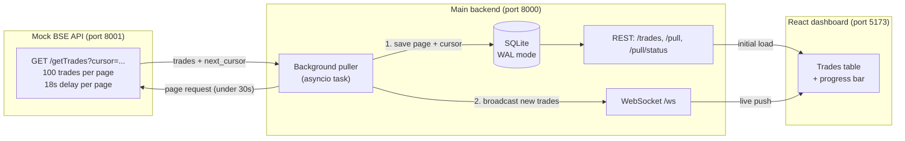

# TradeStream

A live trades dashboard that keeps working while a **15-minute BSE pull** runs under a **30-second connection limit**.

Stack: Python + FastAPI, SQLite (WAL), asyncio, WebSockets, React + TypeScript + Vite.

---

## The problem

- A full pull from the BSE API takes up to **15 minutes**.
- The network kills any HTTP connection held open longer than **30 seconds**.
- So a dashboard that calls `/getTrades` and waits cannot work.

## The solution in one paragraph

The pull runs as a **background task**, fetching trades **page by page**. Every request is short (18s by default, with a 25s timeout), so it always stays under the 30s limit. Each page is **saved to SQLite immediately**, then **pushed to the dashboard over a WebSocket**. The dashboard opens instantly with whatever is already saved and receives new trades live. No page refresh, no polling loop, no cron job or scheduler.

---

## Architecture



### How a pull works

1. The puller requests page 1 from the mock BSE. The page returns after about 18s (900s / 50 pages).
2. It saves the page to SQLite in one transaction, together with the cursor and progress.
3. It broadcasts the new trades and a progress message to every connected dashboard.
4. It follows `next_cursor` until it is `null`. A full pull of 5,000 trades takes about 15 minutes.

### Why this design

| Decision | Reason |
|---|---|
| Separate Mock BSE service | The 30s limit is real: the main backend talks to a remote API it does not control. |
| Paged fetching with a cursor | Every HTTP request stays under 30s, while the whole pull takes 15 minutes. |
| Request timeout of 25s | Above the 18s page time, below the 30s network kill limit. |
| Background asyncio task | The pull does not depend on any open browser or HTTP request. |
| Save first, then broadcast | The dashboard never shows a trade that is not stored. |
| `INSERT OR IGNORE` on `trade_id` | Retries and restarts can never create duplicates. |
| Cursor stored in `pull_runs` | A crash or restart resumes from the last saved page. |
| WebSocket instead of polling | The server pushes only when something changes. |
| `seq` (insertion order) | A reconnecting client asks for `after_seq=N` and never misses or repeats a trade. |
| Heartbeat ping every 20s | Idle connections are not dropped by the network. |

> The brief says the dashboard "consumes /getTrades". Here the **main backend** consumes the mock's `/getTrades` in pages, and the dashboard reads the saved results through `/trades` and `/ws`. A browser cannot wait 15 minutes on a connection that is killed at 30 seconds.

---

## Setup (no Docker needed)

### Prerequisites

- Python 3.10 or newer
- Node.js 18 or newer
- Git

<<<<<<< HEAD
### 1. Clone

```bash
git clone https://github.com/swara-y1711/TradeStream.git
cd TradeStream
```

### 2. Terminal 1: Mock BSE API (port 8001)

```bash
=======
The dashboard can connect to `WS /ws` instead of polling. Pages are saved to
SQLite before their trades are broadcast, and clients can reconnect with
`after_seq` for sequence-based catch-up; replay buffering closes the gap
between replay and live broadcasts. The server sends a heartbeat ping every
20 seconds to keep otherwise idle WebSocket connections alive. For local
verification, `scripts/ws_live_verify.py` is a development-only WebSocket
client.

## Dashboard

The React dashboard loads the latest 200 saved trades and current pull status
once, then receives trade and progress updates through `WS /ws`. It deduplicates
by `seq`, reconnects with sequence-based catch-up if the backend restarts, and
offers filtering by symbol or client without polling or refreshing the page.

Docker is not required.

## Measuring Mock BSE page requests

With Mock BSE running, use the development-only `scripts/measure_requests.py`
tool to time every paginated request:

```bash
python scripts/measure_requests.py http://localhost:8001
```

For the default 5,000 trades and 100-trade pages, each page delay is 18 seconds
(`900 / 50`), below the 30-second connection limit. The main backend uses a
25-second request timeout, leaving room for the response while staying below
that limit.

## Local setup

Use three terminals from the repository root.

```bash
# Terminal 1: Mock BSE
>>>>>>> 24b5222 (Final structure)
cd backend/mock_bse
pip install -r requirements.txt
python -m uvicorn app:app --port 8001
```

### 3. Terminal 2: Main backend (port 8000)

```bash
cd backend/main
pip install -r requirements.txt
python -m uvicorn app:app --port 8000
```

The pull starts automatically when the main backend starts.

### 4. Terminal 3: Dashboard (port 5173)

```bash
cd frontend
npm install
npm run dev
```

Open **http://localhost:5173**.

### Quick demo (30-second pull instead of 15 minutes)

Set these before starting the **mock BSE** (PowerShell):

```powershell
$env:PULL_DELAY_SECONDS="30"
$env:TOTAL_TRADES="500"
```

macOS / Linux:

```bash
export PULL_DELAY_SECONDS=30
export TOTAL_TRADES=500
```

To start from a fresh database, stop the main backend and delete the `data` folder.

---

## Configuration

No `.env` file is needed: every variable has a local default. Copy `.env.example` to `.env` only if you want to change values.

| Variable | Default | Used by | Purpose |
|---|---|---|---|
| `PULL_DELAY_SECONDS` | `900` | Mock BSE | Total duration of a full pull, split across pages |
| `TOTAL_TRADES` | `5000` | Mock BSE | Number of seeded trades |
| `PAGE_SIZE` | `100` | Mock BSE | Trades per page |
| `SEED` | `42` | Mock BSE | Seed for repeatable data |
| `MOCK_BSE_URL` | `http://localhost:8001` | Main backend | Where to pull trades from |
| `DB_PATH` | `./data/tradestream.db` | Main backend | SQLite file location |
| `PAGE_REQUEST_TIMEOUT` | `25` | Main backend | Per-request timeout in seconds (must stay under 30) |
| `WS_PING_SECONDS` | `20` | Main backend | WebSocket heartbeat interval |
| `FRONTEND_ORIGIN` | `http://localhost:5173` | Main backend | Allowed CORS origin |
| `VITE_MAIN_BACKEND_URL` | `http://localhost:8000` | Frontend | Backend base URL (the WebSocket URL is derived from it) |

The mock refuses to start if the per-page delay would exceed 25 seconds, so it cannot break the rule it simulates.

> Tip: the database path is relative. Always start the main backend from the same folder, or set an absolute `DB_PATH`.

---

## API

### Mock BSE (port 8001)

| Endpoint | Description |
|---|---|
| `GET /getTrades?cursor=...` | One page of trades: `{trades, next_cursor, total, page, total_pages}`. No cursor means the first page. `next_cursor` is `null` on the last page. |
| `GET /health` | Health check |

Trade fields: `trade_id`, `client`, `symbol`, `quantity`, `price`, `timestamp`.

### Main backend (port 8000)

| Endpoint | Description |
|---|---|
| `GET /trades?limit=&offset=&after_seq=` | Saved trades plus `total` and `latest_seq`. Instant, even mid-pull. |
| `GET /pull/status` | Pull state, pages done, trades saved, error |
| `POST /pull` | Start a new pull. If one is running, returns the current status. |
| `WS /ws?after_seq=N` | Live updates (see below) |
| `GET /health` | Health check |

### WebSocket messages

| Type | Meaning |
|---|---|
| `hello` | Current pull status and `latest_seq`, sent on connect |
| `trades` | A batch of new trades (each with `seq`) |
| `progress` | Pull status, pages done, total pages, trades saved, error |
| `ping` | Heartbeat |

On connect, the server replays every trade with `seq > after_seq`. Live messages that arrive during the replay are buffered and filtered, so there are no gaps and no duplicates.

---

## Data layer

- **`trades`**: `trade_id` (primary key), client, symbol, quantity, price, timestamp, pulled_at. Indexed on `timestamp` and `pulled_at`.
- **`pull_runs`**: status, `last_cursor`, pages done, total pages, trades saved, error.
- SQLite runs in **WAL mode** with a busy timeout and one short-lived connection per operation, so reads never block the puller.
- Restart behaviour: a running or failed pull resumes from its cursor. A completed pull is **not** re-pulled automatically; use `POST /pull` (or the "Start new pull" button).

---

## Dashboard

- Loads saved trades instantly, then connects to `/ws?after_seq=<latest_seq>`.
- Merges incoming trades by `seq` (no duplicates), newest first.
- Reconnects with backoff (1s, 2s, 4s, up to 10s) and catches up using the highest `seq` it has seen.
- Shows connection state (Live / Reconnecting / Offline), a progress bar, and the total saved.
- Renders the newest 200 rows, with a filter by symbol or client.
- No polling, no refresh.

---

## Tests

```bash
python -m pytest backend/mock_bse/tests -q
python -m pytest backend/main/tests -q
cd frontend && npm run build
```

Covered: pagination and the unsafe-delay check, full pull with no duplicates, retries and failure handling, resume from cursor, `seq` catch-up, WebSocket live delivery, replay without gaps, failed-client isolation.

### Dev tools (not part of the app)

- `scripts/ws_live_verify.py`: connects two WebSocket clients (one early, one late) and checks that both receive every trade exactly once.
- `scripts/measure_requests.py`: records the duration of each page request during a pull (min / max / average) to show requests stay under 30s.

---

## Failure handling

- A failed page is retried 3 times with backoff (1s, 2s, 4s). If it still fails, the run is marked `failed`, and trades already saved are kept.
- A restart resumes from the last saved cursor. At most one page is fetched again, and `INSERT OR IGNORE` makes that harmless.
- A WebSocket client that disconnects or fails on send is dropped without affecting the pull or other clients.

## Production notes

For production I would move SQLite to PostgreSQL, add authentication on the WebSocket, and use a durable job queue if several workers were needed. They were left out here to keep the design simple and easy to explain.
