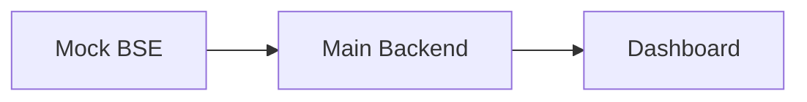

# TradeStream

This repository contains the Task 1 project skeleton: a React dashboard, a main FastAPI backend, and a separate Mock BSE FastAPI service. No market data, storage, scheduled jobs, or WebSockets are included yet.

## Architecture



## Mock BSE API

`GET /getTrades` returns a server-sized page of deterministic seeded trades.
Pass the optional opaque `cursor` query parameter from a prior response to
retrieve the next page; omit it to start a pull.

```json
{
  "trades": [],
  "next_cursor": "opaque-string-or-null",
  "total": 5000,
  "page": 1,
  "total_pages": 50
}
```

The mock uses `SEED` (default `42`), `TOTAL_TRADES` (default `5000`),
`PAGE_SIZE` (default `100`), and `PULL_DELAY_SECONDS` (default `900`). The
delay is split across pages so each request remains below the connection limit.

## Pull mechanism

The main backend starts a background pull when it starts and can also be
triggered with `POST /pull`. It requests Mock BSE one page at a time, saves
each page to SQLite immediately, and resumes from the last saved cursor after
a restart. This avoids holding an HTTP connection open beyond the 30-second
network limit; `GET /pull/status` reports progress and `GET /trades` returns
already saved data while the pull continues.

## Run with Docker

From the repository root:

```bash
docker compose up --build
```

Open <http://localhost:5173>. Health endpoints are available at:

```bash
curl http://localhost:8000/health
curl http://localhost:8001/health
```

Stop the services with `docker compose down`.

## Run without Docker

Use three terminals from the repository root.

```bash
# Terminal 1: Mock BSE
cd backend/mock_bse
python -m venv .venv
.venv\Scripts\activate        # Windows PowerShell
pip install -r requirements.txt
uvicorn app:app --reload --port 8001
```

```bash
# Terminal 2: Main backend
cd backend/main
python -m venv .venv
.venv\Scripts\activate        # Windows PowerShell
pip install -r requirements.txt
$env:MOCK_BSE_URL = "http://localhost:8001"  # optional; this is the default
uvicorn app:app --reload --port 8000
```

```bash
# Terminal 3: Frontend
cd frontend
npm install
npm run dev
```

The frontend development server listens on <http://localhost:5173> and displays the main backend health result.
