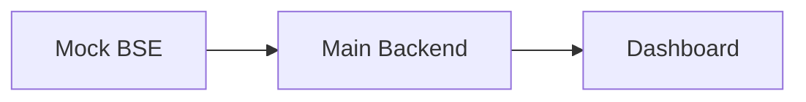

# Arham Fintech Software Engineer Technical Assessment

This repository contains the Task 1 project skeleton: a React dashboard, a main FastAPI backend, and a separate Mock BSE FastAPI service. No market data, storage, scheduled jobs, or WebSockets are included yet.

## Architecture



## Run with Docker

From the repository root:

```bash
docker compose up --build
```

Open <http://localhost:5173>. Health endpoints are available at:

```bash
curl http://localhost:8000/health
curl http://localhost:8001/health
```

Stop the services with `docker compose down`.

## Run without Docker

Use three terminals from the repository root.

```bash
# Terminal 1: Mock BSE
cd backend/mock_bse
python -m venv .venv
.venv\Scripts\activate        # Windows PowerShell
pip install -r requirements.txt
uvicorn app:app --reload --port 8001
```

```bash
# Terminal 2: Main backend
cd backend/main
python -m venv .venv
.venv\Scripts\activate        # Windows PowerShell
pip install -r requirements.txt
$env:MOCK_BSE_URL = "http://localhost:8001"  # optional; this is the default
uvicorn app:app --reload --port 8000
```

```bash
# Terminal 3: Frontend
cd frontend
npm install
npm run dev
```

The frontend development server listens on <http://localhost:5173> and displays the main backend health result.
